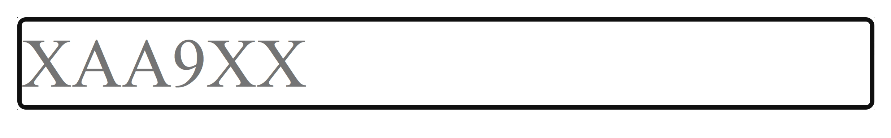
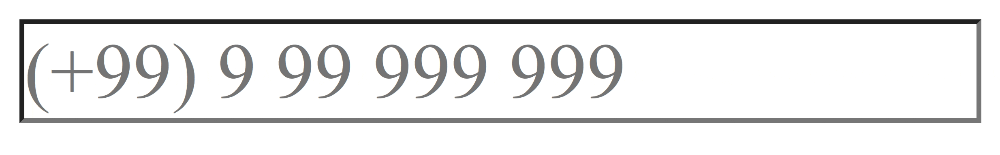
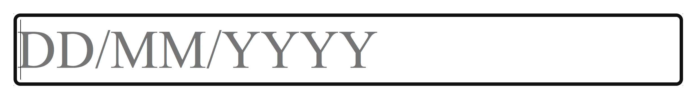
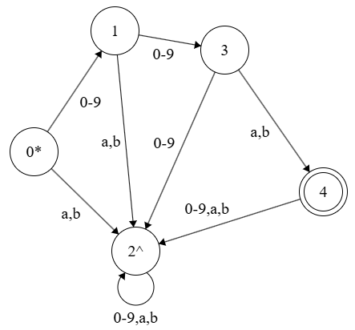

# Masked UI Input Component
This is an input component which requires any user input to comply with a specified pattern. \
The developer utilising this component specifies a regular expression (RegEx), and the component prevents the user from inputting any partial string which does not fit the RegEx pattern. \
Furthermore, the component generates grey placeholder text (alternatively, the placeholder be specified by the developer) which acts as a guide the user can reference as they type. \
Any special characters in the pattern get auto-filled.

For example:
- Victorian license plate number input: \
RegEx: **^([A-Z]{3}\\\\d{3})|(\\\\d[A-Z]{2}\\\\d[A-Z]{2})$** \
Mask: *Auto-generated* \


- International mobile phone number input: \
RegEx: **^[(][+]\\\\d{2}[)] \\\\d \\d{2} \\\\d{3} \\\\d{3}$** \
Mask: *Auto-generated* \



- Date input: \
RegEx: **^(0[1-9]|[12][0-9]|3[01])/(0[1-9]|1[012])/[1-9]\\\\d{3}$** \
Mask: **DD/MM/YYYY** \


## How to import it
Install the masked-ui-input package in your project.

```
$ npm install masked-ui-input
````

Import MaskedInput and call it with input props.

```
import { MaskedInput } from 'masked-ui-input';
```

## Input parameters (props)
- setParentValue?: (value: string) => void - The function to set the value of the user input. 
- regex: string - The desired pattern to which the user input must conform (must obey the rules defined below).
- mask?: string - The placeholder text indicating the desired pattern. If this placeholder does not match up with the regex provided, this parameter will be ignored and the mask will be auto-generated.
- style?: CSSProperties - Custom CSS styling for the input component.

Example:
```
const [inputValue, setInputValue] = useState('');
return <MaskedInput setParentValue={setInputValue} regex={'^[A-Z]{3}$'} mask={'AAA'} style={{fontSize: '2rem'}}/>
```

## Rules for the RegEx
The RegEx provided must abide by the following rules (otherwise a console error is thrown):
- The RegEx must only accept strings of a **fixed-length**. 
### &emsp;&emsp;abc ✅ 
### &emsp;&emsp;\\\\d{3}|[A-Z]{3} ✅ 
### &emsp;&emsp;a* ❌ 
### &emsp;&emsp;[a-z]+ ❌ 
### &emsp;&emsp;\\\\d|\\\\d{2} ❌
- The RegEx can only accept strings whose information is contained within **alphanumeric** characters. Special charcaters are allowed in these strings, but only as constants which can be auto-filled. \
In other words, **there can not be any choice involving a special character** at a given position.
### &emsp;&emsp;12|89 ✅ 
### &emsp;&emsp;\\\\d/\\\\d ✅ 
### &emsp;&emsp; \\\\d(/|-)\\\\d ❌
### &emsp;&emsp; [.,] ❌
### &emsp;&emsp; AND|&&& ❌

## How does this actually work?
A RegEx cannot validate a partial string. So in order to determine whether the next character a user inputs is valid, the RegEx is transformed into a Discrete Finite Automaton (DFA). Then, we can determine whether a partial input ends up in a trap state of this DFA, which means that the input is not permitted.
Here is the algorithm employed for [converting a RegEx into a DFA](https://www.geeksforgeeks.org/compiler-design/regular-expression-to-dfa/). \
Note that prior to applying the algorithm, most RegExes must first be simplified.

As an example: \
Initial RegEx: **^\\\\d{2}[ab]$** \
Simplified RegEx: **(0|1|2|3|4|5|6|7|8|9)(0|1|2|3|4|5|6|7|8|9)(a|b)** \
DFA: \

